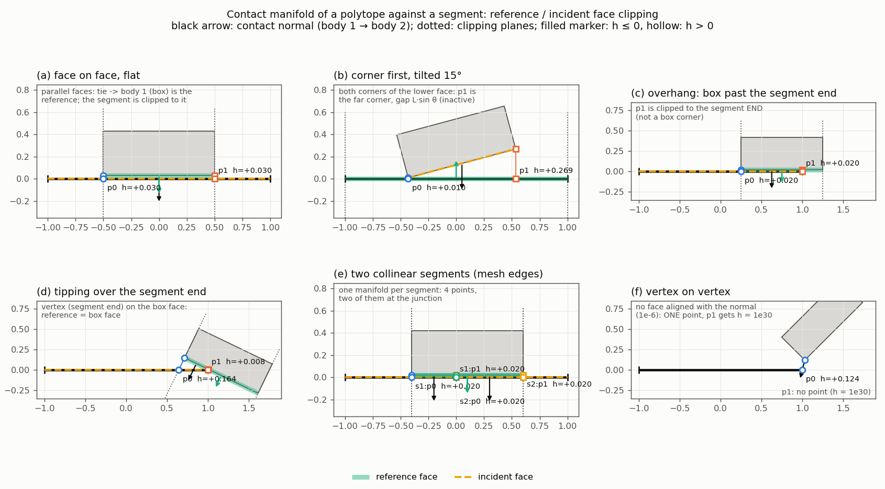
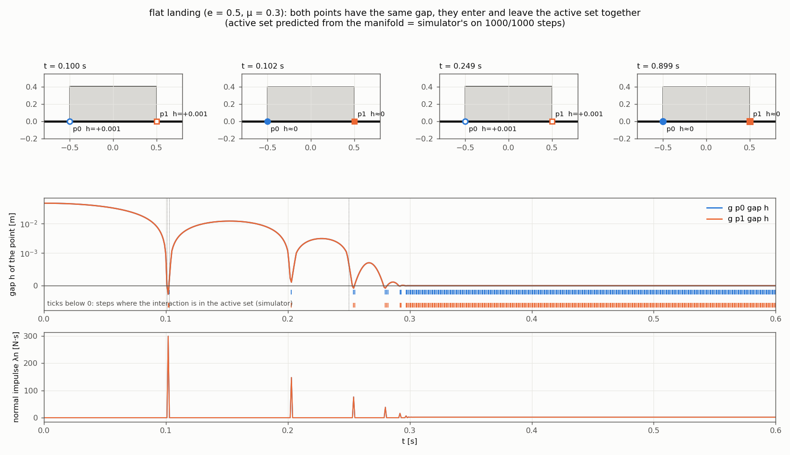
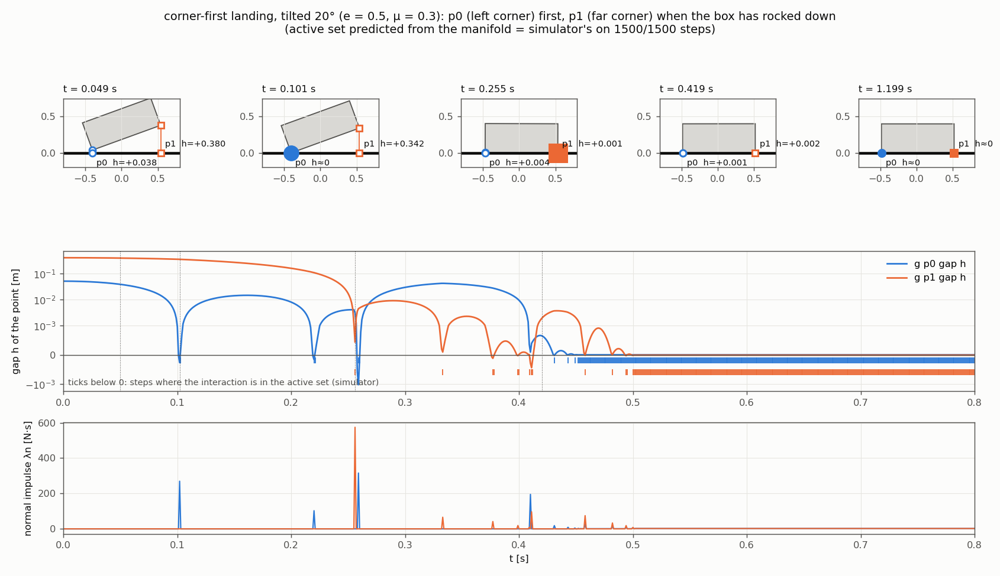
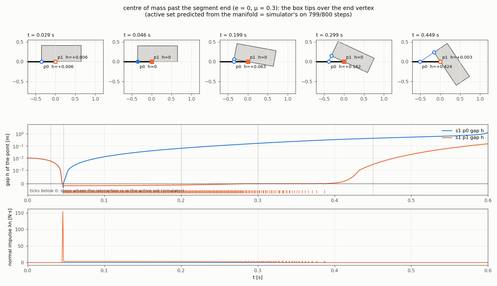
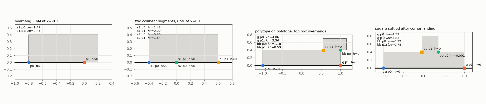
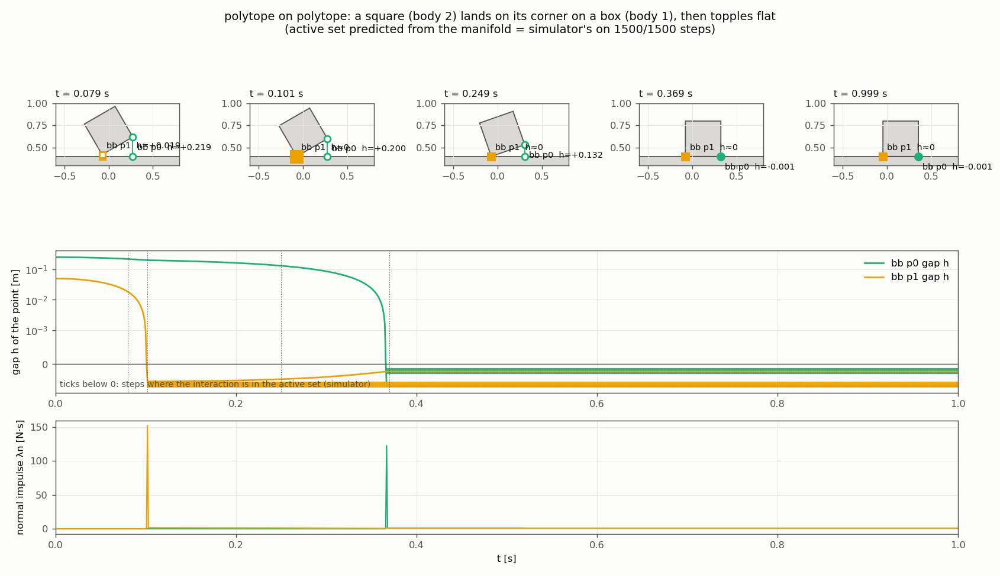

# Polytope contacts in the vkernel: the two interactions of a pair

How a 2D polytope touching a segment (a fixed segment, a mesh edge) or
another polytope is turned into Moreau–Jean interactions: how many are
created, where their contact points are, and when each becomes active.
The figures come from vnative simulations (Moreau–Jean, θ = 1/2, γ = 1/2,
h = 1e-3, NSGS 2D friction) of main-devel after 7ed68269a. The
comparison of the time integrators is in
[time-integrators-mj-at-dem.md](time-integrators-mj-at-dem.md).
All the bodies here are rigid, so θ = 1/2 is safe. With a FEM body
(a polytope on mesh edges) use θ slightly above 1/2, since θ = 1/2 is the
stability limit of the stiffness: see *θ and stability* in that document.

Code: `collision/cxd_narrowphase.hpp` (`narrowphase_pair`,
`clip_manifold`, `manifold_point`), `collision/polytopefsegment_r.hpp`,
`polytopemesh_r.hpp`, `polytopepolytope_r.hpp`,
`collision/space_filter.hpp` (creation) and `simul/contacts.hpp`
(`activation`). Introduced in 507272945, e2caf33ce and 2173c1193.

## 1. Three layers

```
 broadphase (space_filter)     the pair is near     -> 2 interactions, point_index 0 and 1
        |                                              (both exist as long as the pair is near)
 narrowphase (every compute_h)  geometry at q_k      -> normal n + manifold of 1 or 2 points
        |                                              interaction i reads point i: (h_i, cp1_i, cp2_i)
 active set (Moreau-Jean step)  y_k + γ h ẏ_k <= 0   -> the rows of the frictional contact problem
```

1. **Creation, from proximity only.** When the neighbour search finds a
   polytope near a segment, a mesh edge or another polytope, the
   space_filter creates **two interactions**, `point_index = 0` and `1`.
   For a fixed segment both share one relation item per
   (segment, point_index). For a mesh edge the key is
   (mesh, edge, point_index). For a polytope pair the generic `diskdisk_r`
   binding is rebound by `cxd_narrowphase::rebind` to two
   `polytopepolytope_r` items. Creation looks at no geometry beyond
   proximity: both interactions exist whatever the configuration.
   Disk × polytope and the disk relations keep **one** interaction.

2. **Narrowphase: one manifold per pair, recomputed at every
   configuration.** `narrowphase_pair` finds the contact normal `n`
   (body 1 → body 2) with cxd. When the bodies are apart, it uses the GJK
   distance (closest features). When they overlap, it uses the EPA depth
   (least-penetration axis), with a separating-axis fallback. Then
   `clip_manifold` builds the manifold (the Box2D `b2CollidePolygons`
   construction, fig. 1):
   - On each shape it takes the face whose outward normal is closest to
     `+n` (body 1) or `−n` (body 2). A segment is a single face with both
     normals.
   - **If neither face is aligned with `n` to within 1e-6**
     (`align < 1 − 1e-6`, about 0.08°), the closest features are two
     vertices: the manifold has **one point** (fig. 1f).
   - Otherwise the more aligned face is the **reference face**. Equal
     faces go to body 1; body 2 wins only if it is better by more than
     1e-3, so the choice does not flip-flop. The other face is the
     **incident face**.
   - The incident face is **clipped** to the extent of the reference face
     (the dotted lines in fig. 1). The two ends of the clipped incident
     face are the two contact points:
     - `h_i` = signed distance of the clipped point along the
       **reference-face normal**;
     - `cp` on the incident shape = the clipped point; the witness on the
       reference face = its projection.
   - The two points are **ordered along the tangent `t = (−n_y, n_x)`**,
     and that order is all `point_index` means. With body 1 above the
     ground, `n` points down and `p0` is the left point. With body 1
     below (stack, fig. 5), `n` points up and `p0` is the **right** point.
     The index has no geometric identity: it follows from the normal and
     the body order.

   Interaction `i` reads `manifold_point(c, i)`: its own `h_i`, `cp1_i`,
   `cp2_i`, and the **shared** normal `n`. Its Jacobian is the
   `diskdisk_r`-style two-row `G` with lever arm `cp1_i − c(q)`. A point
   the manifold does not have (the one-point case) gets
   `h = inactive_gap() = 1e30`, so it is never active.

3. **Activation is the usual Moreau–Jean rule, applied to each point
   separately.** The step is `outputs(q_k)` → `free_outputs` →
   `active_set` → ..., and `contacts::activation` is
   ```
   active  <=>  y_k + γ h ẏ_k <= threshold          (γ = 1/2, threshold = 0)
   ```
   with `y_k = h_i(q_k)` and `ẏ_k = G_i v_k`, i.e. the gap predicted at
   mid-step. Nothing ties the two points of a pair together: **each
   becomes active when its own clipped point is predicted to close within
   half a step.** Being active only means the point is a row of the FC2D
   problem; its impulse can still be 0. That happens, for example, at the
   step after an impact (fig. 2), or for p0 in fig. 4 at t = 0.046.

## 2. The cases (fig. 1, computed with the Python port of `clip_manifold`)



| case                                        | reference / incident                           | points                                                                                 | consequence                                                                                |
|---------------------------------------------|------------------------------------------------|----------------------------------------------------------------------------------------|--------------------------------------------------------------------------------------------|
| (a) flat face on face                       | tie → body 1 (polytope); segment clipped to it | the two corners, equal h                                                               | both active on the same step                                                               |
| (b) corner first, tilt θ                    | segment (align 1) / lower box face             | p0 the corner (h≈0); p1 the **far corner**, h ≈ L sin θ                                | p1 exists from the start with a large gap; it activates only when the box has rotated down |
| (c) overhang                                | box face / segment, clipped to the box         | box corner and the **segment end**                                                     | the support is the segment end, not a box vertex                                           |
| (d) tipping over the end                    | box face (align 1) / segment                   | the segment end (h≈0), and the foot of the box face's far end on the segment (large h) | contact = segment end vertex on the box face                                               |
| (e) two collinear segments (two mesh edges) | one manifold **per segment**                   | 4 points, **two coincident at the junction**                                           | redundant rows, statically indeterminate (§3)                                              |
| (f) vertex on vertex                        | no face within 1e-6                            | **one** point (closest features); p1 has h = 1e30                                      | only one interaction can be active                                                         |

A polytope pair behaves the same way, with a polygon face in place of the
segment: fig. 6 is case (b) between two polytopes, and the stack in fig. 5
is case (c).

## 3. What happens in the simulations

Scenes: a 1.0 × 0.4 box, density 1000, μ = 0.3. All seven scenes were
checked step by step. The active set predicted from the Python manifold
port plus the activation rule above (configuration and velocities at the
start of the step) equals the simulator's active set on **every step** of
all seven scenes. The one exception, tipping at t = 0.306, has
y + ½hẏ = 2.4e-8, inside the float32 noise of the HDF5 output. The contact
points also match the simulator's `cf` rows (to within the motion of one
step).

**Flat landing, e = 0.5 (fig. 2).** The two gaps are identical, so both
points enter the active set on the same step. At t = 0.102 each takes
λn = 299 N·s, half of (1+e)·m·v. After each impact there is one more
active step with λ = 0 before the box lifts off. From 0.297 s both stay
active, each carrying m g h / 2.



**Corner-first landing, tilted 20° (fig. 3).** p1 is the far corner and
exists from t = 0 with h ≈ 0.38. Only p0 hits at 0.102. The box then
rocks: p0 and p1 have alternating impacts (0.22, 0.256, 0.33, 0.38,
0.41 …), each point's activation following its own gap. Both points are
permanently active only from ≈ 0.5 s. This alternation is the expected
behaviour of a rocking box under Moreau–Jean with e = 0.5, not a defect
of the two-point manifold.



**Tipping over the segment end (fig. 4).** The CoM is 0.15 past the end.
At landing both points are active (box corner and segment end), and p0
has λ = 0. From then on only p1, the **segment end**, is active. While
the box rotates, the manifold switches to case (d): the segment end
vertex on the box face. p1 carries the whole support while the box pivots,
then chatters (0.28–0.39 s) as it slides off the end. After that the
manifold becomes vertex–vertex (one point, p1 = 1e30) and the box falls
away.



**At rest (fig. 5), per-step impulses (m g h = 3.92 N·s for the box).**
- *Overhang*, CoM at x = −0.3, supports at −0.8 (box corner) and 0
  (segment end): λ = 1.47 / 2.45, which is **exactly the lever rule**
  (0.375 / 0.625).
- *Two collinear segments*, CoM at 0.1: four active rows, at −0.4, 0, 0
  and 0.6. The two junction rows share 0.80 + 0.00 in an **arbitrary
  split**. The total moment is balanced, but the problem has a singular
  Delassus matrix (duplicate rows) and the split is whatever NSGS lands
  on. The same holds for a polytope lying across **two mesh edges** of a
  FEM body: each edge brings its own pair of points, clipped to that edge.
- *Polytope on polytope*, small box overhanging the edge of the large one:
  the points are the small box's corner (x = 0.55) and the **large box's
  corner** (x = 1.0), with λ = 0.59 / 1.18 = 1/3 / 2/3 (lever rule). Here
  body 1 is the lower box, so `n` points up and p0 is the right point.



**Square on its corner on a box (fig. 6, polytope × polytope).** Case (b)
between two polytopes. bb p1 (the corner) activates at 0.102. bb p0 (the
other end of the incident face, h = 0.2 → 0) activates at 0.367, when the
square has toppled flat. Afterwards both stay active.



## 4. Remarks for the scheme comparisons (MJ / Anitescu–Tasora / DEM, see [time-integrators-mj-at-dem.md](time-integrators-mj-at-dem.md))

- The manifold is **recomputed from the geometry at every configuration**,
  and so are the point positions (clipped ends, segment ends). An
  interaction is a *slot* (point_index), not a material point. When the
  topology of the manifold changes (face ↔ vertex, two points ↔ one
  point, slot reordering after the normal flips), the λ of a slot jumps
  to another physical point. A scheme that warm-starts or carries
  per-contact history (tangential spring in DEM, warm start in
  Anitescu–Tasora) inherits this.
- The 1e-6 face-alignment tolerance is tight. A box resting flat but
  tilted by more than ~1e-3 rad still gets two points, because the
  segment is then the aligned reference face. But a polytope **vertex
  against a vertex** (segment end or polygon corner) gives a single
  point.
- Coincident points at mesh-edge junctions (fig. 5, second panel) create
  duplicate rows. This is harmless for NSGS, which picks one split, but it
  matters for solvers sensitive to a rank-deficient H, the known
  robustness fault line of Newton-type FC solvers. For DEM-style penalty
  it **doubles the stiffness** at the junction.
- Each point gets its own gap but they **share the normal** `n` of the
  pair, so the gaps are measured along the reference normal. In case (b)
  with a large tilt this is the segment normal, which is consistent. In
  case (d) it is the box-face normal.

## 5. Reproduce

From a siconos build with the python bindings (`-DWITH_PYB11_WRAPPER=1`,
component `vkernel`), after the default target:

```
cmake --build <build> --target vkernel_study_polytope_contact_manifolds
```

This runs the scenes, the check and the figures into
`<build>/vkernel/soa/notes/polytope-contact-manifolds/`. The figures
need matplotlib, which is in the development environment of `guix.scm`
(`guix shell -D -f guix.scm`). Without matplotlib they are skipped.

`nonos/bridge.py` comes from the source tree, so the build must match
the sources. The figures of this document are copies of the outputs.

`polytope-contact-manifolds/scripts/`:

| file          | what                                                                                                                                                                        |
|---------------|-----------------------------------------------------------------------------------------------------------------------------------------------------------------------------|
| `run.py`      | the driver of the target (`run.py --build-dir <build> --out <dir>` by hand): the nonos package of the build, the environment, one process per scene, the check, the figures |
| `scenes.py`   | the seven scenes, vnative backend, one hdf5 file per scene                                                                                                                  |
| `manifold.py` | the Python port of the manifold (normal, `clip_manifold`, ordering, 1e30)                                                                                                   |
| `sim.py`      | reads a scene, rebuilds the manifolds, predicts the active set, matches the `cf` rows                                                                                       |
| `check.py`    | the step-by-step comparison of the active sets                                                                                                                              |
| `figs.py`     | the figures                                                                                                                                                                 |
