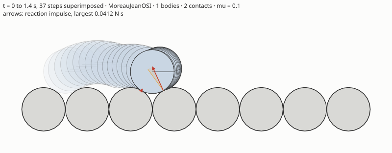

# SVG pictures of a 2D simulation

Pictures of a 2D mechanics simulation at chosen times, and animations of
its output steps: the static objects, the bodies with their shape, the FEM
meshes deformed, the contacts (the reaction impulse, the Coulomb cone, the
force chains), the fixed segments hatched on their material side so that a
floor reads as a floor, and the (r_n, r_t) plot of the contacts of a step.
One self-contained SVG file per picture (no script, no external file), for
figures and for checking a scene by eye; for large runs, use the ParaView
export ([paraview-vtkhdf-export.md](paraview-vtkhdf-export.md)).

Code: `io/python/svg.py` (the pictures, the side inference, the
animations, the converter, the pictures of a run),
`io/python/mechanics_run.py` (run options `svg_output`, `svg_options`;
`output_svg`), `io/python/scripts/siconos_svg.py` (the command). Test:
`vkernel/src/siconos/vkernel/tests/test_svg.py` (ctest
`vkernel_python_svg`). Examples: `svg-display/scripts/examples.py`
(section 6).


## 1. Making the pictures

### During the simulation

```python
run_options["svg_output"] = "0.5,1.0,120"
run_options["svg_options"] = {"animate": True, "coulomb": True}  # optional
```

or, for any python driver, `siconos --svg-output 0.5,1.0,120 driver.py`.
A value with a decimal point (or an exponent) is a time, an int a
simulation step number (its time is k h). The picture is made at the step
k with t_k <= request < t_k + h, whether it is an output step or not; a
request the run does not reach is reported on stderr. The files are
`<hdf5 file>_svg_<time>.svg` beside the HDF5 file, the time with 6
decimals and zero padded (`run_svg_000001.250000.svg`) so that they sort.

`svg_options` holds the drawing options of section 2 (`mode`, `arrows`,
`chains`, `cones`, `scale`, `colour`, `material_sides`, `labels`) and
those of the run: `directory`, `coulomb` (the Coulomb plot of each
picture), `animate` and `strobe` (of the output steps, written at the end
of the run as `<hdf5 file>_svg_animation.svg`, `_svg_strobe.svg`; the
steps are held in memory), `uniform`, `discrete`, `speed` (section 4).

The run draws from the arrays it writes in the HDF5 tables, rounded to
float32 as the tables are: it works with `output_format` `"vtkhdf"` (no
`dynamic` table), and its pictures of an output step, its animation and
its Coulomb plots are the same bytes as the converter's (tested). A run
continued from its file (cold restart) counts the contacts of the steps
already in the file for the sides of the segments, as the converter does.

Cost: off unless requested; a step without a picture costs the test of the
requested times (24 µs measured). A picture is written element by element
to its file. Measured (`bench_inrun.py`, siconos.asor-work/svg: 1000 disks
in a box, 50 steps, CPU, 4 OpenMP threads, a picture every 5 steps): 0.033
s per picture (140 KB, circle mode with arrows), against 3.5 ms per step
of that run, so about 10 steps; the run took 0.53 s with 10 pictures, 0.18
s without. At 20000 disks (same script, CUDA build, cuNSearch, 4 OpenMP
threads): 0.110 s per picture (1.77 MB, `use` mode), 10 µs per step
without picture, 4 ms once at the first step; the run took 1.57 s with 10
pictures, 0.45 s without,
about 9 ms per step. That scene is barely loaded (the disks fall from a
grid: 142 contacts at the end), so a step of a settled pile costs more and
the share of the pictures is smaller. The cost is that of the renderer
(python), the same on the CPU and CUDA builds: 0.033 s at 1000 disks on
both.

### After the simulation

```
siconos_svg run.hdf5                          # the last output step
siconos_svg run.hdf5 --time 0.5 --time 1.0    # the output steps at or before
siconos_svg run.hdf5 --frame 0 --frame -1     # output step indices
siconos_svg run.hdf5 --time 0.27 -o fig.svg
siconos_svg run.hdf5 --dir pictures --coulomb # and the Coulomb plots
siconos_svg run.hdf5 --animate --stride 2     # every second output step
siconos_svg run.hdf5 --strobe --stride 10 --frame 3
```

A file only has its output steps: a time between two of them draws the
one before, never an interpolation, and the title gives both times
(`t = 0.25 s (requested 0.27)`); a time before the first output step is
an error. With `--animate` or `--strobe`, `--frame N` is the frame N of
the animation (of the steps kept by `--stride`) and the pictures of
`--time` and `--frame` are drawn in the view of the animation: a picture
is then the still of that frame. The file needs a step index
(`data/step_index`, the files of 2026 on).

In the guix container the installed scripts do not start (no
`/usr/bin/env`): `python3 <install>/bin/siconos_svg run.hdf5`.

### PNG

A conversion, not an output: `rsvg-convert -o fig.png fig.svg` (in the
guix container: `guix shell librsvg -- rsvg-convert ...`), or Inkscape,
or cairosvg. They draw the first frame of an animation.

## 2. What is drawn

In this order, each layer in a fixed order so that a file is the same
bytes from one run to the next (coordinates in px with 2 decimals, the
bodies by id, the contacts by (ds1, ds2, interaction)):

1. the static objects alive at the time (`static_geometry` of
   `vtkhdf.ShapeTable`, as in ParaView), one group per object: closed
   polygons (Box2d, fixed disks) filled grey, segments as lines, hatched
   on their material side (section 3);
2. the FEM meshes, deformed by the displacements of the FEM tables, one
   path per body;
3. the bodies, with their shape (the blocks of `ShapeTable`: disks with a
   rotation tick, convex polygons, Box2d, composite bodies), rotated by
   their angle, coloured on a fixed five-colour ramp by `colour`: `speed`
   (|v|, the default), `omega` (|ω|) or `none`; the legend gives the range
   of the drawn step (of the whole animation in an animation);
4. the contacts:
   - the force chains (`chains`): a line between the centres of the two
     bodies of a contact, to the contact point for an obstacle, its width
     by r_n in 8 classes;
   - the Coulomb cones (`cones`): half-angle atan(mu) about the normal, at
     the point of ds1;
   - the arrows (`arrows`): the reaction impulse on ds1 (column `reaction`
     of `cf`, H^T lambda), of length by `scale`: `proportional` (the
     largest of the step is 1.2 typical body sizes), `fixed` (the
     direction only) or `log` (over 3 decades). The edges of a cone are as
     long as its arrow: the tip of the arrow is on an edge exactly when the
     contact is at the limit, |r_t| = mu r_n (tested on a disk bouncing
     and sliding, then rolling). It is an impulse under Moreau-Jean, not a
     force, and the title says so with the largest value in N s.

The title gives the time drawn (and the one requested), the integrator
(`osi` of the run options, in `data/siconos_mechanics_run_options`; files
of runs before the run options were output again have none), the numbers
of bodies, FEM bodies and contacts, the friction coefficients and what the
arrows and chains show.

| bodies        | mode (`--mode auto`)                                         |
|---------------|--------------------------------------------------------------|
| up to 2000    | `circle`: one element per body, a rotation tick on the disks |
| up to 20000   | `use`: each shape once in `<defs>`, one `<use>` per body     |
| above         | `bins`: the bodies merged in one path per colour, no outline |

| contacts      | drawn by default                                             |
|---------------|--------------------------------------------------------------|
| up to 20      | arrows and cones                                             |
| up to 2000    | arrows                                                       |
| above         | force chains                                                 |

`--arrows`, `--chains`, `--cones` and their `--no-` forms force them;
`--labels` writes the body ids.

### The Coulomb plot

`--coulomb` (`coulomb` in `svg_options`) writes, for each picture,
`<hdf5 file>_coulomb_<time>.svg`: r_t / (mu r_n) of the contacts of the
step with r_n > 0 against r_n on a log scale (the impulses of a pile span
decades: a linear plot crowds the light contacts at the origin), the cone
edges r_t = ±mu r_n as the lines ±1, the contacts at the limit (|r_t| >=
(1 - 1e-3) mu r_n) in red, and their fraction among the contacts with r_n
> 0. Frictionless contacts (mu = 0) are counted, not drawn.

### Sizes

Measured on a lattice of disks (bench_scale.py, siconos.asor-work/svg;
converter time on the CPU, rsvg-convert at 1600 px):

| bodies | circle, with arrows      | use                       | bins                      |
|--------|--------------------------|---------------------------|---------------------------|
| 1000   | 0.33 MB, 0.05 s          | 0.055 MB, 0.009 s         | 0.063 MB, 0.010 s         |
| 10000  | 3.3 MB, 0.28 s, rsvg 1.1 s | 0.55 MB, 0.04 s, rsvg 0.65 s | 0.60 MB, 0.05 s, rsvg 0.54 s |
| 100000 | 33 MB, 3.4 s, rsvg 6.1 s | 5.5 MB, 0.37 s, rsvg 3.2 s | 6.0 MB, 0.51 s, rsvg 2.0 s |

The merged paths are not smaller than the `<use>` (each arc repeats the
radius), they render faster.

## 3. The material side of a segment

A segment has no side in the model (`collision/shape/segment.hpp`). The
side is inferred:

- from the contacts with the segment. A contact with a fixed obstacle has
  ds1 == ds2 (the body: the obstacle is not named in `cf`) and its
  `point_a` on the obstacle; it is matched to the segment by distance
  (1e-5 of the scene diagonal). Its normal points from the obstacle into
  the body: the material is on the other side. A contact at an end point,
  its normal nearly along the segment, does not count. The contacts are
  those of the output steps up to the drawn one (all of them in an
  animation, so the hatch does not change from frame to frame);
- without contact, from the bodies near the segment (centre within two
  typical sizes, projection inside the segment), at the drawn step then
  at the first output step;
- with bodies on both sides (a wall between two compartments), or none,
  the segment is not hatched and a warning names it (static id and end
  points).

When the inference is wrong (a ledge hit once from below is hatched on
top), give the side: `--material-side ID=+1` hatches the segments of the
static object ID (a negative id) on the side of perp(p2 - p1), p1 and p2
the end points of the segment, `-1` on the other. A side declared in the
scene would be a change of the HDF5 format, left to the hdf5_v2 work.

## 4. Animations

`--animate` writes the output steps as an SVG animation (SMIL, no
script): one group per body with an `animateTransform` of its translation
and one of its rotation (unwrapped, no jump of 2π), an `animate` of its
fill when it is coloured and of its visibility when it is absent from
some steps (births, removals); the static objects shown while alive; the
FEM meshes as an `animate` of their path; the contacts of each step shown
at that step only (three values per step, not one per frame), moving with
their body ds1 until the next step (the translation of its centre and the
rotation about it, from this step to the next), so that they stay on the
body while it is interpolated; a time bar.

- Playback: the physical times of the steps (real time; `--speed 2` twice
  faster), or `--uniform`, one frame per output step of 0.1 s (the
  step-to-step behaviour: chattering, a drift); `--discrete` draws each
  step as it is, without interpolation between them.
- Frames are output steps: an animation is never finer than
  `output_frequency`. `--stride k` keeps every k-th step.
- A browser (Firefox, Chromium) plays it. A viewer without SMIL
  (rsvg-convert, Inkscape, print) shows the first step: every animation
  has its stills, `--frame N` (section 1). Checked in Firefox (icecat,
  headless, `setCurrentTime`): the disk of the bounce example is in the
  air at t = 0.2 and rolling with its contact at t = 1.5.
- Cost: about 30 bytes per body and frame, all the frames held in memory
  (in the run as in the converter). Above a few thousand bodies × frames,
  use `--stride`, `--colour none` (no fill animation) and `--no-arrows`;
  the contacts are left out when a step has more than 2000.

`--strobe` writes the steps superimposed in one still picture, the earlier
ones fainter: a trajectory, a limit cycle, the contacts of the last step.

## 5. Units and options in short

| option        | values                         | default        |
|---------------|--------------------------------|----------------|
| `mode`        | auto, circle, use, bins        | auto           |
| `arrows`      | True, False, None              | ≤ 2000 contacts |
| `chains`      | True, False, None              | > 2000 contacts |
| `cones`       | True, False, None              | ≤ 20 contacts  |
| `scale`       | proportional, fixed, log       | proportional   |
| `colour`      | speed, omega, none             | speed          |
| `material_sides` | {static id: ±1}             | inferred       |
| `labels`      | True, False                    | False          |

## 6. Examples

All made by one command, from a python build tree (the PYTHONPATH of the
ctests); each simulation runs in its own process with the vnative backend
(Moreau-Jean, NSGS at 1e-10, h = 0.005), the HDF5 and SVG files in
`<directory>`:

```
python3 vkernel/docs/notes/svg-display/scripts/examples.py <directory> [case ...]
```

The figures below are copies of its output (10 s for the small cases, 150
s for DamBreak 40 on the CPU with `OMP_NUM_THREADS=4`). Budget: the 500 KB
of the `check-added-large-files` hook per committed file. The DamBreak
animation (1.8 MB) is not committed: `examples.py <directory> dambreak`
writes it as `dambreak_svg_animation.svg`.

| case | file | size |
|------|------|------|
| incline_stick | [incline_stick_svg_000001.000000.svg](svg-display/incline_stick_svg_000001.000000.svg) | 2.2 KB |
| incline_slide | [incline_slide_svg_strobe.svg](svg-display/incline_slide_svg_strobe.svg), [animation](svg-display/incline_slide_svg_animation.svg) | 4.1, 15 KB |
| sliding | [sliding_svg_strobe.svg](svg-display/sliding_svg_strobe.svg) | 3.8 KB |
| column | [column_svg_animation.svg](svg-display/column_svg_animation.svg) | 86 KB |
| shear | [shear_svg_strobe.svg](svg-display/shear_svg_strobe.svg) | 11 KB |
| bounce | [bounce_svg_000000.455000.svg](svg-display/bounce_svg_000000.455000.svg), [Coulomb](svg-display/bounce_coulomb_000000.455000.svg), [animation](svg-display/bounce_svg_animation.svg) | 3.2, 1.3, 266 KB |
| dambreak | [dambreak_svg_000002.231372.svg](svg-display/dambreak_svg_000002.231372.svg), [front](svg-display/dambreak_front_svg_000002.231372.svg), [Coulomb](svg-display/dambreak_coulomb_000003.347058.svg) | 198, 210, 24 KB |

- **incline_stick**: a square on a 20° incline, mu = 0.5 > tan 20°: at
  rest, the two reactions inside their cones (|r_t| / (mu r_n) from 0.20
  to 0.97 over the run), the incline hatched below.

  

- **incline_slide**: 30°, mu = 0.3 < tan 30°: it slides, the reactions on
  the edge of the cones (|r_t| = mu r_n at all 102 contacts; strobe: the
  positions superimposed).
- **sliding**: a square thrown at 2 m/s on a floor, mu = 0.3: it stops at
  x = 0.680 at t = 0.68 (v²/(2 mu g) = 0.680 m).
- **column**: five disks dropped 0.01 above each other, played one frame
  per output step (`uniform`, `discrete`): the step-by-step settling.
- **shear**: a disk thrown over a layer of fixed disks, its rotation nearly
  locked: it climbs over the crests (dilatancy). The fixed disks are drawn
  as polygons, from the ParaView geometry (`static_geometry`).

  

- **bounce**: a disk thrown along a floor, e = 0.5, mu = 0.1. The still is
  the first impact (t = 0.455): the reaction on the edge of its cone (the
  contact slides), and its Coulomb plot, 1 of 1 contact at the limit. The
  animation shows the bounces, then the rolling.
- **dambreak**: `bench-dambreak.py 40` (1054 disks, 82 rocks, 165 terrain
  segments, lengths in disk radii u): the grains settle behind the gate,
  the gate is removed, they flow down the slope. The still at 2T/3 shows
  the force chains (width by r_n) and the terrain hatched below it; the
  vertical end wall of the valley, never reached, is not hatched (warned).
  The front is a crop (`view`, said in the title). The animation (not
  committed) keeps every 12th output step without colour. The Coulomb
  plot at T: 903 of 1409 loaded contacts at the limit (64%), r_n from
  1e-15 (solver noise) to 1e4 kg u/s, the liquid around 1, the rocks up
  to three decades above.

  
