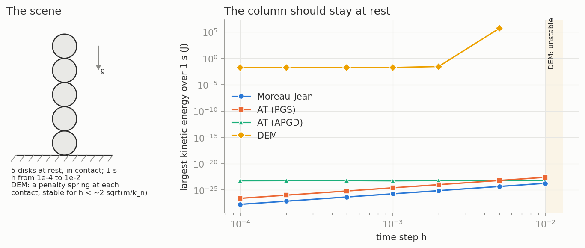
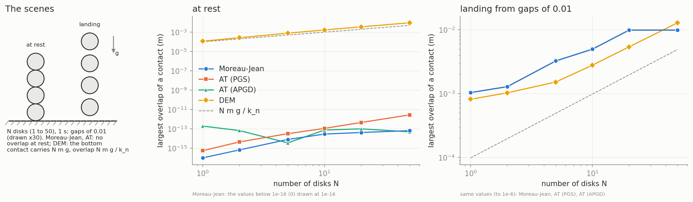
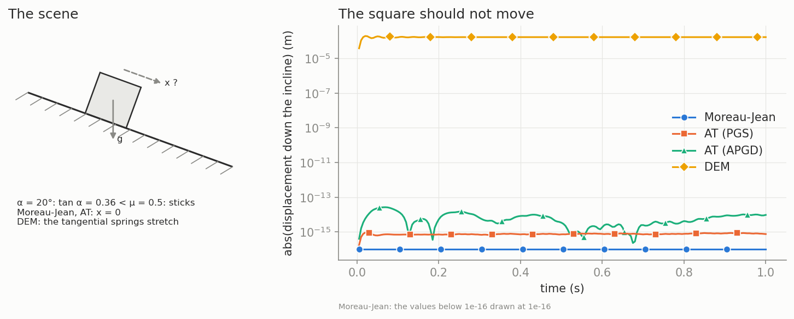
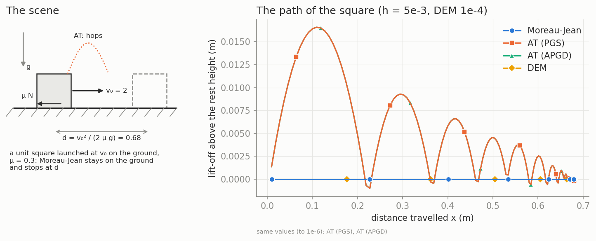
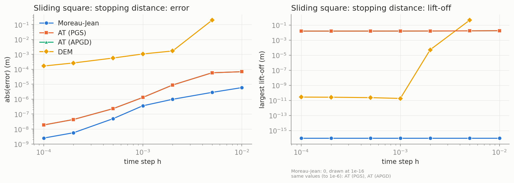
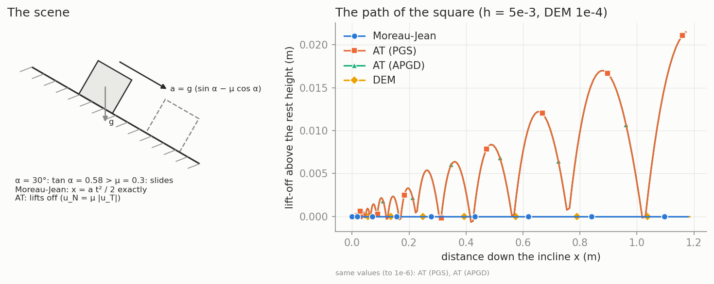
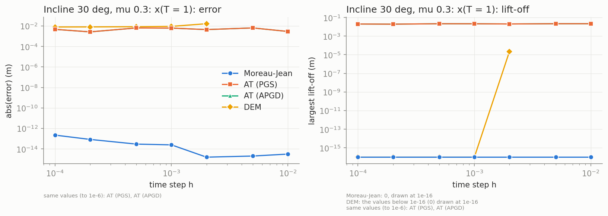
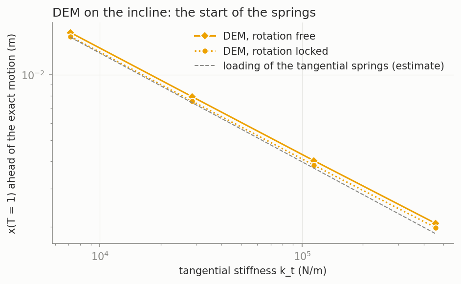
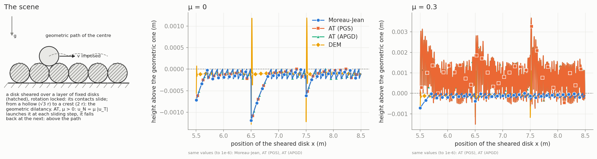
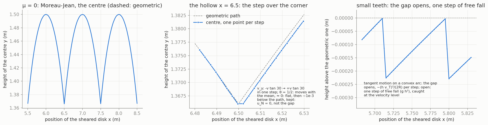

# Time integrators: Moreau–Jean, Anitescu–Tasora, explicit DEM

The vkernel targets NSCD, the Moreau–Jean scheme. The Anitescu–Tasora (AT)
and explicit DEM schemes are there **for comparison only**. The goal is
test cases with a measured number, analytic when possible, that show where
NSCD wins and where all the schemes agree.

The contact geometry these scenes rely on (polytopes, two contact points
per pair) is described in
[polytope-contact-manifolds.md](polytope-contact-manifolds.md).

## 1. The schemes

| scheme | file | contact law | solver | scheme value |
|---|---|---|---|---|
| Moreau–Jean | `simul/moreau_jean.hpp` | Signorini + Coulomb at the velocity level, Newton impact law | NSGS (fc2d) on the assembled problem | 0 (1: global, MoreauJeanGOSI) |
| AT (PGS) | `simul/anitescu_tasora.hpp` | cone complementarity, u ∈ K* = {u_N ≥ μ\|u_T\|} (convexified Coulomb), no gap/h stabilization | matrix-free projected Gauss–Seidel, warm started | 2 |
| AT (APGD) | same | same | APGD (Mazhar et al. 2015) on the assembled problem of Moreau–Jean (works with FEM) | 3 |
| DEM | `simul/dem.hpp` | penalty spring–dashpot normal, tangential spring capped by Coulomb (Cundall–Strack, history per interaction) | explicit: forces h F through the Moreau–Jean velocity correction, θ = 1 for rigid bodies (symplectic Euler), implicit θ method kept for FEM | 4 |

In python (vnative): `run_options["osi"]` = `nonos.bridge.AnitescuTasoraOSI`,
`AnitescuTasoraAPGDOSI` or `ExplicitDEMOSI`. See
`tests/sliding_square_schemes.py`.

Settings of the comparisons:
- Moreau–Jean (NSGS) and AT: solver tolerance 1e-12, activation threshold
  1e-10, θ = 0.5.
- DEM: k_n = 1e5, damping ratio 0.5 (on a contact with the ground),
  k_t = 2/7 k_n, θ = 1.

The scenes are shared with the ctest `vkernel_nscd_cases`
(`collision/tests/nscd_world.hpp`, `collision/tests/nscd_cases.cpp`). That
ctest checks the analytic NSCD cases to rounding error:
- sliding square stopping distance: 5.9e-6, 2.8e-6 and 3.6e-7 at h = 1e-2,
  5e-3 and 1e-3, with no lift-off;
- incline below the friction angle: \|x\| < 1e-16;
- incline above the friction angle: \|x − a t²/2\| < 3e-14;
- column of 1 to 50 disks at rest: interpenetration < 1e-13.

## 2. Summary

| case | Moreau–Jean | AT (PGS = APGD) | DEM |
|---|---|---|---|
| column of 5 at rest, h 1e-4 … 1e-2: stability | KE ~1e-24 at every h | KE ~1e-23 at every h | KE 2e-2 (does not settle in 1 s); blows up from h = 5e-3 |
| column at rest, N 1 … 50: overlap | 0 (< 1e-13) | < 3e-13 | bottom N m g / k_n (exact to N = 5; N = 20, 50 not settled) |
| column landing from gaps 0.01 | 1.04e-3 for every N (~ v h / 2: the O(h) drift, independent of N) | same as MJ (to 1e-6) | ~ N m g / k_n at the end |
| incline 20°, μ 0.5 (sticks) | \|x\| < 3e-13 | < 4e-10 (CCP = Coulomb when sticking) | slips 1.9e-4, then holds 1.67e-4 |
| sliding square v0 = 2, μ 0.3: stopping distance error | 6e-6 (h 1e-2) to 2e-9 (h 1e-4) | 7e-5 to 2e-8, converges | −2e-1 at 5e-3 (rocking unstable) to −1.7e-4 at 1e-4 |
| sliding square: lift-off | 0 | **1.6e-2 at every h** | ~1e-11 for h ≤ 1e-3 |
| incline 30°, μ 0.3 (slides): x(T = 1) error | < 3e-13 at every h | 3e-3 … 6e-3, does not converge with h; lift-off 2e-2 | ~8e-3 at h ≤ 1e-3 (start-up transient of the tangential springs, §3.6) |
| dilatancy, disk sheared over a layer, μ = 0 | 3.5e-6 above / 1.2e-3 below the geometric path | = MJ (to 1e-6) | 1.2e-3 / 1.3e-3 |
| dilatancy, μ = 0.3 | 3e-6 / 7e-4 (follows the path) | **3.7e-3** / 1.5e-3 (launched by u_N = μ\|u_T\|) | 1.1e-3 / 1.4e-3 |
| cost at the same h | about equal for all (per-step overhead) | 10–15× the solver iterations of NSGS | the small h it needs |

To be fair to the other schemes:
- At μ = 0, AT is the same scheme as NSCD: a column dropped with gaps
  agrees to 3e-11 with PGS and 6e-12 with APGD.
- In dilute flows all the schemes agree.
- NSCD has its own O(h) position drift at the velocity level. The landing
  column measures it, and it is not claimed as an advantage.

## 3. The cases

### 3.1 Stability: a column of 5 disks at rest

DEM is stable only for h below ~2 √(m / k_n). Its overlap is the elastic
one, 7.65e-4, whatever h. Moreau–Jean and AT stay at rest to rounding
error at every h.



| h | Moreau-Jean KE | AT (PGS) | AT (APGD) | DEM |
|---|---|---|---|---|
| 1e-04 | 1.90e-28 | 2.62e-27 | 5.83e-24 | 1.73e-02 |
| 1e-03 | 1.90e-26 | 2.62e-25 | 5.67e-24 | 1.75e-02 |
| 5e-03 | 4.74e-25 | 6.54e-24 | 6.75e-24 | 4.77e+05 |
| 1e-02 | 1.90e-24 | 2.62e-23 | 7.10e-24 | unstable |

### 3.2 Column of N disks: at rest and landing

At rest, the DEM bottom overlap is N m g / k_n, so k_n must grow (and h
shrink) with N. NSCD has no overlap.

When the column lands from gaps of 0.01, Moreau–Jean and AT both keep an
overlap of 1.04e-3 for **every N**. This is the O(h) velocity-level drift
(~ v h / 2) and it does not depend on N. The DEM bottom overlap grows like
N.



| N | MJ at rest | DEM at rest | N m g / k_n | MJ landing (end) | DEM landing (end) |
|---|---|---|---|---|---|
| 1 | 0 | 9.81e-05 | 9.81e-05 | 1.04e-03 | 9.81e-05 |
| 10 | 0 | 1.01e-03 | 9.81e-04 | 1.04e-03 | 1.05e-03 |
| 50 | 0 | 8.13e-03 | 4.90e-03 | 1.04e-03 | 3.77e-03 |

Wall time for 1 s: about 0.05 s for MJ and AT, 2.2–2.7 s for DEM (its h).
For a column of 50 landing: MJ 0.32 s, AT PGS 1.94 s, APGD 0.08 s.

### 3.3 Static friction: incline 20°, μ = 0.5

The square should stick (tan 20° < 0.5). Moreau–Jean: \|x\| = 1.4e-17. AT:
< 3e-14 (the CCP equals Coulomb when sticking). DEM slips 1.9e-4 during
the transient while its tangential springs load, then holds at 1.67e-4.



### 3.4 Sliding square, v0 = 2, μ = 0.3: stopping distance

The exact stopping distance is d = v0² / (2 μ g) = 0.68.



**The AT signature.** On the first sliding step the convexified law gives
u_N = μ\|u_T\|, so v_y = μ v_x = 0.55 m/s. The square flies v²/(2g) ≈
1.5e-2 and then hops along. This lift-off does **not** shrink with h
(1.55e-2 at h = 1e-4), against the h μ \|u_T\| per step that was expected.
The stopping distance is still nearly right.



| h | MJ error | AT error | DEM error | MJ lift-off | AT lift-off | DEM lift-off |
|---|---|---|---|---|---|---|
| 1e-02 | 5.94e-06 | 6.91e-05 | unstable | 0 | 1.76e-02 | unstable |
| 1e-03 | 3.59e-07 | 1.30e-06 | -1.07e-03 | 0 | 1.57e-02 | 1.81e-11 |
| 1e-04 | 2.47e-09 | 1.87e-08 | -1.66e-04 | 0 | 1.55e-02 | 2.74e-11 |

Cost at h = 1e-3: wall time 0.21 s for MJ (1006 NSGS iterations), 0.24 s
for AT PGS (18441), 0.21 s for APGD (14848), 0.20 s for DEM. A DEM square
on two corner springs needs h < 2 / √(3 k_n / m), or it rocks (the 5e-3
failure).

### 3.5 Incline 30°, μ = 0.3: sliding, x(T = 1)

The exact motion is x = g (sin α − μ cos α) T² / 2. Moreau–Jean is exact to
< 3e-13 at every h. AT hops (lift-off ~2e-2), which makes x(T) wrong by
3e-3 to 6e-3 at every h: it does not converge. DEM is ahead by ~8e-3 for
h ≤ 1e-3, see §3.6.




### 3.6 DEM on the incline: the friction deficit is a start-up transient

The tangential springs start unloaded. Until 2 k_t x = μ m g cos α
(~6.5 ms at k_t = 2/7 k_n), the friction is below its cap and the square
moves as a mass on a spring, x_eq (1 − cos ωt) with ω = √(2 k_t / m). It
gets ahead of the Coulomb motion by dv = x_eq ω sin(ω t_c) − a t_c, and it
keeps that lead. Once the springs are loaded, the friction is exactly
μ F_N. The excess goes like k_t^(−1/2):

| rotation | k_t | excess x(T) − x_exact | estimate |
|---|---|---|---|
| free | 7.14e+03 | 1.56e-02 | 1.49e-02 |
| free | 2.86e+04 | 7.93e-03 | 7.44e-03 |
| free | 1.14e+05 | 4.03e-03 | 3.72e-03 |
| free | 4.57e+05 | 2.08e-03 | 1.86e-03 |
| locked | 7.14e+03 | 1.50e-02 | 1.49e-02 |
| locked | 4.57e+05 | 1.99e-03 | 1.86e-03 |

The estimate agrees to 2–7% with the rotation locked. With the rotation
free the excess is ~5% larger (rocking).



### 3.7 Dilatancy, minimal form: a disk sheared over a layer of fixed disks

The scene:
- The layer is touching fixed disks (`diskfdisk_r`, obstacles without
  dofs).
- The horizontal velocity of the disk is imposed by a horizontal mass of
  1e4 (it travels 2.993 for 3, because friction acts on the mass).
- Its rotation is locked, so the contacts slide. Gravity is the load.
- The geometric path is y = r + max_i √(4r² − (x − x_i)²), from a hollow
  (√3 r) to a crest (2 r).



| μ | scheme | h | max above | max below | solver iterations | wall time (s) |
|---|---|---|---|---|---|---|
| 0 | Moreau-Jean | 0.005 | 3.49e-06 | 1.19e-03 | 2402 | 0.52 |
| 0 | AT (PGS) | 0.005 | 3.49e-06 | 1.19e-03 | 2988067 | 0.91 |
| 0 | AT (APGD) | 0.005 | 3.49e-06 | 1.19e-03 | 13160 | 0.45 |
| 0 | DEM | 1e-04 | 1.19e-03 | 1.28e-03 | 0 | 24.84 |
| 0.3 | Moreau-Jean | 0.005 | 3.08e-06 | 7.17e-04 | 2402 | 0.47 |
| 0.3 | AT (PGS) | 0.005 | 3.68e-03 | 1.51e-03 | 5789159 | 0.68 |
| 0.3 | AT (APGD) | 0.005 | 3.68e-03 | 1.51e-03 | 18866 | 0.56 |
| 0.3 | DEM | 1e-04 | 1.12e-03 | 1.35e-03 | 0 | 23.59 |

**μ = 0: Moreau–Jean = AT.** Both enforce u_N = 0, never the gap, and have
no position projection.
- *The big dips, at the hollows (x = 5.5, 6.5, 7.5).* The path has a
  corner there: v_y flips from −v tan 30° to +v tan 30° in one step. With
  θ = 1/2 the position moves with the mean of the two velocities, ≈ 0, so
  the centre stays flat over that step while the path goes up. The centre
  ends ~1e-3 below the path (at most h v tan 30° = 1.4e-3; at x = 5.5,
  starting from v_y = 0, exactly h v tan 30° / 2 = 7.2e-4).
- *The small teeth (~2e-4, period ~0.1).* The tangential motion over a
  convex arc opens the gap by ~(h v_T)² / (2R) per step. When the gap is
  open (3.5e-6 = max above), there is one step of free fall, caught at the
  velocity level with the overlap kept, and again.

**μ = 0.3.** Moreau–Jean follows the geometric path. AT is launched by
u_N = μ\|u_T\| at each sliding step and falls back at the next: a band at
the step frequency, 3.7e-3 above the path. DEM overshoots both ways at the
hollows.



This is the elementary mechanism, a sliding contact over a bump, not a
dense packing with rolling. The dilatancy of a real packing (many disks,
rolling, a shear cell with moving walls or periodic boundaries) is still
open.

Two notes on this case:
- A first version made the layer immobile with large masses. The W block
  of a contact between two such bodies is ~1e-18, NSGS refuses it as
  singular, and the disk fell through. Fixed disks remove the problem.
- 6 of the 4800 AT steps stop at an error of 1.3e-12 to 1.3e-11 for a
  1e-12 tolerance.

## 4. Findings beyond the schemes

- **Loose solver tolerance makes resting contacts chatter**, for every
  iterative solver. At 1e-8, the inexact velocities let a resting gap
  drift above the activation threshold (1e-10) within a few hundred steps.
  The contact drops out, the body falls by g h², and impacts. This was
  seen with MJ on columns of 20 disks and with APGD on 1 disk. It is not a
  scheme property; the comparisons use 1e-12.
- **The default `constraint_activation_threshold` is 0.** A resting contact
  at gap 0 is then active or not depending on the sign of 1e-17 rounding
  errors. A dropped row lets the body fall g h² and tilt. The tests use
  1e-10.
- **`fc2d_lemke` returns a wrong solution with info 0** on the stopping
  step of the sliding square (a penetrating contact, friction of the wrong
  sign). NSGS is used instead.
- AT with PGS from a cold start: 10332 sweeps for a resting column of 20
  disks, 337 when warm started. APGD: 404 cold, 42 warm.

## 5. Reproduce

`nscd_comparisons` (`vkernel/soa/src/siconos/tests/nscd_comparisons.cpp`)
is built with the vkernel tests (`WITH_vkernel_TESTING`). It writes one
CSV per case, and all the cases take about 1.5 min. The plot script,
`time-integrators-mj-at-dem/scripts/nscd_comparisons_plot.py`, makes
`tables.md` (the full tables, of which §3 gives excerpts) and one PNG per
case. Each PNG has a scene panel (bodies, ground, gravity, the imposed
motion, what each scheme does) next to the data. The target runs both:

```
cmake --build <build> --target vkernel_study_time_integrators
```

The outputs go to `<build>/vkernel/soa/studies/time-integrators-mj-at-dem/`.
The PNGs need matplotlib, which the build environment does not have:
without it, the target writes `tables.md` only. To get the plots, run the
script on the same directory with matplotlib:

```
guix shell python python-matplotlib -- python3 \
  vkernel/docs/studies/time-integrators-mj-at-dem/scripts/nscd_comparisons_plot.py \
  <build>/vkernel/soa/studies/time-integrators-mj-at-dem
```

The figures here come from the run of 2026-10-30 (commits 95ae14f98 to
909ff40a3).
